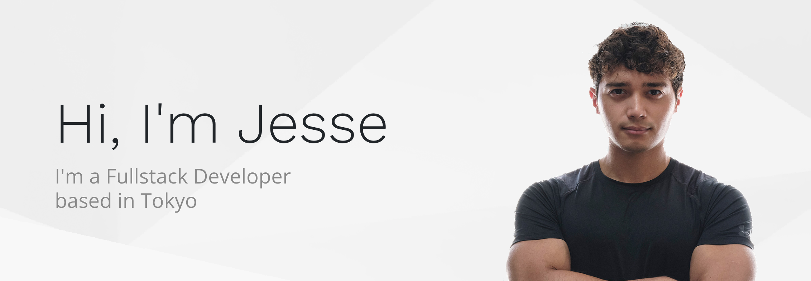

<!--  -->

## About Me:

**Freelance Frontend Engineer** and dedicated **Next.js Specialist** in Tokyo for ecommerce and health/fitness sectors. I turn designs and prototypes into products you can put in front of customers.

Most of what I get hired for is the last mile: a prototype that works on the founder's laptop, a Figma file built through rounds of customer interviews, a frontend written fast that can no longer be changed. I take those to production, where they meet real users, real payments, and real edge cases. I ship whole features, backend included.

Im currently building **Crewcade** for brand partnerships for fitness communities in Tokyo and APAC region.

##

- 💻 Over a decade developing web applications for startups and small businesses — e-commerce, and fitness
- 🎓 Graduated Western Washington University with a BA in Management Information Systems
- ⚙️ **Typescript Focused:** My go-to stack is **Next.js** with **Nest JS** or **Payload CMS**, typically within a PNPM monorepo. I regularly convert Figma designs to working applications and work with backend engineers to implement APIs as necessary (Swagger/OpenAPI, GraphQL, or tRPC).
- 🏃 **Director of SOGO Fitness**, a ten-year-old Tokyo fitness community, and organizer of **Midnight Runners Tokyo** — one of 18 chapters worldwide.
- 👍 Working on my own SaaS, but open to work on a select few projects.

## What I'm Building:

**[Crewcade](https://crewcade.com)** — a booking and payments platform for independent fitness instructors in Japan. Multi-tenant, bilingual (en/ja), Stripe Connect, RFC 5545 recurring scheduling. In limited production while I pilot it with the community I organize in Tokyo.

## Current Stack:

**Deep** — TypeScript · React · Next.js (App Router) · state and data layers · design systems · performance · accessibility

**Comfortable, shipping in production** — Node · NestJS · PostgreSQL · Prisma · Stripe · OAuth · Payload CMS · typed API clients (OpenAPI/Orval, tRPC, GraphQL) · PNPM monorepos · CI/CD

##

📍 Tokyo (JST) · Full overlap with APAC, mornings with the US West Coast · US citizen, W-9/1099

**[jessealvarado.com](https://jessealvarado.com)** · **[contact@jessealvarado.com](mailto:contact@jessealvarado.com)**
